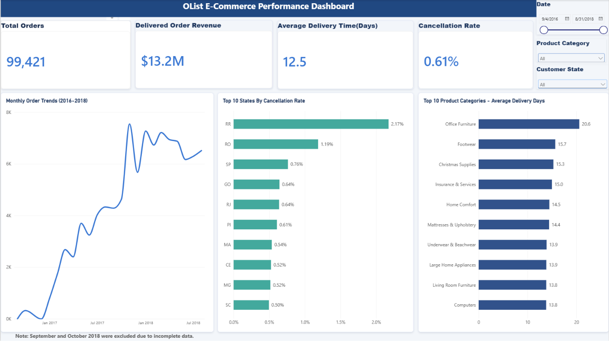

# Olist E-Commerce Performance Dashboard

## Project Overview

This project analyzes the performance of the Olist Brazilian e-commerce marketplace using Microsoft Power BI.

The dashboard provides an interactive overview of order volume, delivered-order revenue, delivery efficiency, and cancellation rates.

The analysis helps identify marketplace trends, geographic differences in cancellations, and product categories experiencing longer delivery times.

## Business Question

How is the Olist marketplace performing in terms of order volume, delivered-order revenue, delivery efficiency, and cancellations?

## Tools Used

- Microsoft Power BI
- Power Query
- DAX (Data Analysis Expressions)

## Key Performance Indicators (KPIs)

The dashboard tracks four key performance indicators:

| KPI | Result |
|---|---|
| Total Orders | 99,421 |
| Delivered Order Revenue | $13.2M |
| Average Delivery Time | 12.5 days |
| Cancellation Rate | 0.61% |

These KPIs provide an overview of marketplace activity, revenue performance, delivery efficiency, and order cancellations.

## Dashboard Preview

The interactive dashboard includes:

- Monthly order trends (2016–2018)
- Top 10 states by cancellation rate
- Top 10 product categories by average delivery time
- Date, product category, and customer state slicers
-

## Key Findings and Business Insights

### 1. Order Volume Trends
Order volume increased substantially throughout 2017, indicating growing marketplace activity. Monthly orders fluctuated during 2018, highlighting the importance of monitoring demand patterns.

### 2. Geographic Cancellation Rates
Roraima (RR) recorded the highest cancellation rate among the displayed states at 2.17%, followed by Rondônia (RO) at 1.19%. These differences suggest areas requiring further investigation.

### 3. Product Category Delivery Performance
Office Furniture recorded the longest average delivery time among the displayed categories at 20.6 days, compared with the overall average of 12.5 days. This highlights opportunities to investigate delivery efficiency in slower-performing categories.

## Business Recommendations

### 1. Monitor Order Demand
Track monthly order trends to identify seasonal fluctuations and support inventory and operational planning.

### 2. Investigate High-Cancellation States
Review cancellation reasons in Roraima (RR) and Rondônia (RO), considering order volumes before prioritizing interventions.

### 3. Improve Delivery Efficiency
Investigate delivery delays in Office Furniture and other slower-performing categories to identify opportunities for logistics improvements.

## Conclusion

The Power BI dashboard provides a centralized view of Olist marketplace performance, helping identify demand patterns, geographic cancellation differences, and delivery inefficiencies to support data-driven business decisions.

## Reporting Period

September 4, 2016 – August 31, 2018.

September and October 2018 were excluded because of incomplete data.